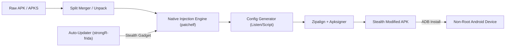
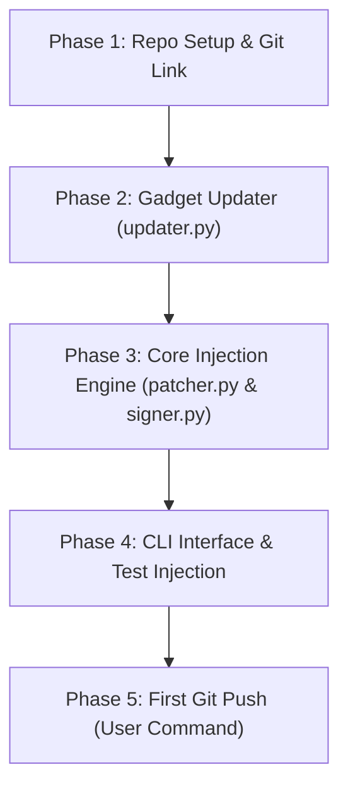

# GADGET_WORK: Automated Stealth Frida-Gadget Toolchain

## 1. Executive Summary & Objective

`GADGET_WORK` is an automated, self-updating reverse engineering pipeline specifically engineered for non-rooted Android environments running in Termux with ADB capabilities.

Its core purpose is to automate the end-to-end injection of **stealth Frida Gadgets** into unmodified production APKs (such as Unity/Il2Cpp 3D games) without triggering anti-cheat mechanisms (like Garena Thor, Tencent ACE, or DexGuard) and without requiring device root.



---

## 2. Architectural Pillars

### A. Pure Native Injection (Zero-Smali Footprint)
Instead of relying on slow, error-prone bytecode decompilation (`apktool d`) which breaks DexGuard/multidex:
* Uses **`patchelf --add-needed`** to link the renamed stealth gadget directly to an existing native library (`libunity.so`, `libmain.so`, etc.).
* When Android's linker loads the game engine, the gadget is automatically loaded into the process memory before any game logic or anti-cheat initializes.
* Execution time drops from minutes to **2–4 seconds**.

### B. Auto-Updating Stealth Gadget Cache
* Matches the exact version of Termux's local Frida environment (`frida --version`).
* Automatically queries and pulls pre-patched stealth gadget releases (`strongR-frida` / `hluda`) directly from GitHub releases for `arm64-v8a` and `armeabi-v7a`.
* Strips all `frida`, `gum`, and default D-Bus strings on download.

### C. Camouflaged Identity & Configuration
* Dynamically renames the gadget library per target (e.g., `libmain_shim.so` or `libgles_compat.so`).
* Generates paired `.config.json` files supporting two operational modes:
  1. **Listen Mode:** Opens a custom, non-standard loopback port for interactive attaching (`frida -H 127.0.0.1:<port>`).
  2. **Script Mode:** Bundles and auto-executes target hook scripts (e.g., `simcity.js`) directly on game boot without requiring an active network connection.

### D. Safe Device Isolation
* All gadget assets and scripts reside exclusively inside the repacked APK.
* System directories like `/data/local/tmp` remain entirely untouched, ensuring sensitive games (like Free Fire) will never encounter Frida files or ports.

---

## 3. Storage & Environment Strategy

The repository will live at `/storage/emulated/0/GADGET_WORK`:

> [!IMPORTANT]
> **Android FUSE/Shared Storage Limitations:**
> `/storage/emulated/0` does not support UNIX executable permissions (`chmod +x` is ignored) and can produce Git filemode noise.
> * **Mitigation 1:** The toolchain will be driven by Python 3 (`python3 gadget_work.py ...`), ensuring cross-filesystem execution regardless of mount flags.
> * **Mitigation 2:** Git repository will be configured with `git config core.filemode false` and clean `.gitignore` rules for APK build outputs.

---

## 4. Repository Layout

```text
/storage/emulated/0/GADGET_WORK/
├── .git/                     # Linked to github.com/anonymous5-coder/GADGET_WORK
├── bin/                      # Symlink to launcher script in ~/bin
├── cache/                    # Cached stealth gadget binaries (.so.xz)
│   ├── arm64-v8a/
│   └── armeabi-v7a/
├── configs/                  # Gadget config templates (listen vs script mode)
├── scripts/                  # Game-specific Frida hooks (simcity.js, hoc.js)
├── input/                    # Target APKs to be patched
├── output/                   # Signed, ready-to-install APKs
├── core/
│   ├── __init__.py
│   ├── updater.py            # strongR-frida GitHub release fetcher
│   ├── patcher.py            # Native ELF injection via patchelf
│   ├── signer.py             # Zipalign & Apksigner wrapper
│   └── adb_helper.py         # Device install & verification
├── gadget.py                 # Unified CLI entry point
├── README.md
└── .gitignore
```

---

## 5. Phased Implementation Plan



### Phase 1: Repository & Environment Initialization
* Initialize git inside `/storage/emulated/0/GADGET_WORK`.
* Configure Git user identity and set remote origin to `git@github.com:anonymous5-coder/GADGET_WORK.git`.
* Apply `core.filemode false`.

### Phase 2: Stealth Gadget Auto-Updater (`core/updater.py`)
* Detect local Frida client version (`17.x` or installed CLI).
* Download, unpack, and verify `strongR-frida` gadgets for `arm64-v8a` into `cache/`.

### Phase 3: Fast Native Injection Engine (`core/patcher.py` & `core/signer.py`)
* Implement pure-native ZIP manipulation with `patchelf`.
* Generate customized stealth runtime configuration (`.config.json`).
* Sign using Android standard debug key via `zipalign` and `apksigner`.

### Phase 4: CLI Integration (`gadget.py`)
* Provide clean command interface:
  ```bash
  python3 gadget.py patch input/simcity.apk --script scripts/simcity.js --install
  python3 gadget.py update
  ```

### Phase 5: Verification & Remote Sync
* Test end-to-end injection on an APK.
* Run `git status` review and await user command before running `git commit` and `git push`.
