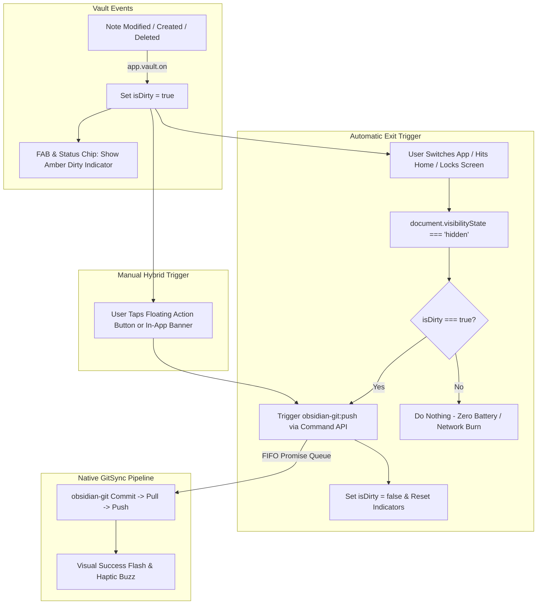

# Project Proposal & Architecture Specification: GitSync Companion

> **Document:** `/storage/emulated/0/Documents/Obsidian/GIT_SYNC_COMPANION_PROPOSAL.md`  
> **Project Name:** `GitSync Companion` (Plugin ID: `git-sync-companion`)  
> **Author:** Antigravity (Systems Architect)  
> **Target Platforms:** Obsidian Mobile (Android / iOS) & Obsidian Desktop (macOS / Windows / Linux)  
> **Primary Ecosystem Companion:** `obsidian-git` (`Vinzent03/obsidian-git`)  
> **Date:** November 16, 2026  

---

## 1. Executive Summary & Product Vision

### 1.1 The Core Problem
`obsidian-git` is the most popular Git plugin for Obsidian, but it has a notorious friction point on mobile devices:
1. **The 1-Minute Hard Limit:** Obsidian Git’s GUI strictly enforces whole integer minutes for debounce timers (`min: 0, step: 1`). The shortest possible debounce delay is **1 minute (60 seconds)**.
2. **The "Quick Exit" Mobile Reality:** Mobile users write quick thoughts or make rapid edits (5–20 seconds) and immediately switch apps, tap Home, or lock their phone.
3. **Android Lifecycle Freeze / SIGKILL:** When an app leaves the foreground, Android throttles or suspends background JavaScript timers (`setTimeout`). If the user swipes Obsidian away from the App Switcher, Android sends `SIGKILL`. Because the 60-second debounce timer was still running in memory, **the commit and push never fire**. Uncommitted files stay trapped on the phone, leading to merge conflicts when remote AI agents or desktop clients sync.
4. **Mobile Navigation Friction:** Accessing the Command Palette or sliding open the left ribbon to tap "Git: Commit and sync" requires multiple swipes and taps on small smartphone screens.

### 1.2 The Hybrid Solution: `GitSync Companion`
`GitSync Companion` is a high-reliability, lightweight companion plugin engineered specifically to close this mobile synchronization gap:
* **Feature A (Automated): Lifecycle Auto-Sync on Exit/App Switch:** Hooks directly into `visibilitychange` and `pagehide`. The millisecond you leave Obsidian, if files were edited, it executes the Git sync pipeline instantly before the WebView is suspended.
* **Feature B (Manual Hybrid): 1-Tap Floating Action Button (FAB):** A sleek, draggable, unobtrusive floating sync button with live dirty-state indicators (Idle $\to$ Dirty $\to$ Syncing $\to$ Success) right on the editing canvas.
* **Feature C (Android Notification / Quick Settings Companion):** In-app status notices, plus an optional Termux / Android Notification Tile bridge for triggering syncs from the system notification shade.

---

## 2. Plugin Naming & Positioning Analysis

| Proposed Name | Plugin ID | Pros | Cons / Verdict |
| :--- | :--- | :--- | :--- |
| **GitSync Companion** *(User Suggestion)* | `git-sync-companion` | Clear, professional, directly conveys companion relationship. | **Recommended Primary Choice.** |
| **Git Mobile Companion** | `git-mobile-companion` | Highlights the mobile-first focus. | Strong alternative; slightly more specific. |
| **Git QuickSync** | `git-quicksync` | Focuses on speed and instant triggers. | Good, but does not highlight companion nature. |

> [!NOTE]
> **Obsidian Community Guidelines Rule:** Plugin names must **not** begin with "Obsidian" (e.g. `Obsidian Git Companion` is disallowed; `GitSync Companion` is compliant).

---

## 3. Detailed Architecture & Technical Mechanics



### 3.1 Feature 1: Lifecycle Auto-Sync Engine
1. **Dirty State Tracker:**
   ```typescript
   this.registerEvent(this.app.vault.on("modify", () => this.markDirty()));
   this.registerEvent(this.app.vault.on("create", () => this.markDirty()));
   this.registerEvent(this.app.vault.on("delete", () => this.markDirty()));
   this.registerEvent(this.app.vault.on("rename", () => this.markDirty()));
   ```
2. **DOM Visibility & Pagehide Listeners:**
   ```typescript
   const onLifecycleExit = () => {
       if (document.visibilityState === "hidden" && this.isDirty) {
           this.isDirty = false;
           this.triggerGitSync("lifecycle-exit");
       }
   };
   document.addEventListener("visibilitychange", onLifecycleExit);
   window.addEventListener("pagehide", onLifecycleExit);
   ```
3. **Execution via Public API:**
   Invokes `this.app.commands.executeCommandById("obsidian-git:push")`. This seamlessly leverages Obsidian Git’s built-in FIFO promise queue, credential store, and isomorphic-git engine without duplicating complex Git code.

---

### 3.2 Feature 2: 1-Tap Trigger UI (Floating Action Button & In-App Notice)

#### A. The Floating Action Button (FAB)
* **Visual Appearance:** A subtle, semi-transparent circle (36px–44px) fixed in the corner (default: bottom-right above mobile navigation).
* **Draggable:** Supports touch-drag (`touchstart`, `touchmove`, `touchend`) so users can move it anywhere on the screen. The position is persisted in `data.json`.
* **State Machine:**
  1. `idle`: Dimmed opacity (0.4), subtle git branch icon.
  2. `dirty`: Opacity 1.0, pulsing accent badge (indicating uncommitted notes).
  3. `syncing`: Rotating sync spinner icon.
  4. `success`: Green checkmark icon with subtle haptic vibration (Android `navigator.vibrate(50)`).
* **Single Tap:** Instantly executes Git Sync.

#### B. In-App Interactive Notice (Settings Option)
* Displays an interactive dismissible banner when notes are edited:
  `[● Changes detected | Sync Now]`

#### C. Android Notification Shade Integration (Feasibility & Implementation)
* **Android WebView Limitation:** In Android 13+, posting native Android notifications requires `POST_NOTIFICATIONS` runtime permission declared in the Android Manifest. Obsidian Mobile’s APK does **not** declare `POST_NOTIFICATIONS` in its manifest (verified via ADB). Therefore, no pure JavaScript plugin can natively post Android system notifications directly.
* **The Hybrid Solution (Two-Tier Approach):**
  1. **Tier 1 (Universal Obsidian Plugin):** FAB + In-App Interactive Banner (works everywhere: Android, iOS, Windows, Mac, Linux).
  2. **Tier 2 (Android / Termux Companion Bridge):** For Android users running Termux, a lightweight Termux script provides a persistent Android notification tile in the system drawer:
     * Tapping `[SYNC]` in Android Notification executes a 1-second SSH push via Termux or launches Obsidian via deep link: `obsidian://advanced-uri?commandid=obsidian-git:push`.

---

### 3.3 Feature 3: Sub-Minute Fast Debounce (Optional Setting)
* Provides a fast debounce timer (e.g. 15s or 20s) that fires automatically while still inside the app, solving Obsidian Git’s 1-minute minimum limitation.

---

## 4. Source Tree & Modular Design

```
git-sync-companion/
├── .github/
│   └── workflows/
│       └── release.yml        # Automated build & GitHub release pipeline
├── src/
│   ├── main.ts                # Plugin lifecycle (onload, onunload)
│   ├── dirtyTracker.ts        # Vault event hooks & dirty-state management
│   ├── lifecycle.ts           # Mobile visibilitychange & pagehide handlers
│   ├── fab.ts                 # Floating Action Button (DOM, touch drag, states)
│   ├── settings.ts            # Configuration tab (FAB toggles, position, opacity)
│   └── types.ts               # State interfaces & settings types
├── styles.css                 # CSS animations, FAB styles, badge indicators
├── manifest.json              # Obsidian plugin metadata
├── package.json               # Build tools (esbuild, typescript, obsidian types)
├── tsconfig.json              # TypeScript compilation config
├── README.md                  # Comprehensive user guide, mobile GIFs, FAQ
└── LICENSE                    # MIT License
```

---

## 5. Development, Release & Community Submission Roadmap

### Phase 1: Local Prototype & Verification (Immediate)
1. Write the clean TypeScript / ES bundle into `.obsidian/plugins/git-sync-companion/`.
2. Enable it in Obsidian Mobile (`community-plugins.json`).
3. Verify live: Edit a note $\to$ immediately swipe app away $\to$ verify instantaneous commit & push on GitHub!

### Phase 2: Standalone GitHub Repository Setup
1. Create a dedicated GitHub repository: `https://github.com/anonymous5-coder/git-sync-companion`.
2. Initialize repository with clean source code, TypeScript configuration, build scripts (`esbuild`), and MIT License.
3. Add GitHub Actions CI (`.github/workflows/release.yml`) that automatically compiles `main.js` and creates release packages whenever a tag (e.g. `1.0.0`) is pushed.

### Phase 3: Community Plugin Submission
1. Ensure full compliance with Obsidian Plugin Guidelines:
   * Clean `onunload()` disposing of all DOM elements, event listeners, and timers.
   * No desktop-only APIs called without platform checks (`Platform.isMobileApp`).
   * No telemetry, no obfuscation.
2. Draft documentation and mobile screen captures for `README.md`.
3. Submit a Pull Request to [obsidianmd/obsidian-releases](https://github.com/obsidianmd/obsidian-releases) adding `git-sync-companion` to `community-plugins.json`.

---

## 6. Architecture Decision Records (ADR)

* **ADR 1: Standalone Companion vs. Forking Obsidian Git:**
  * *Decision:* Standalone companion.
  * *Rationale:* Forking `obsidian-git` creates a maintenance nightmare (merging upstream changes from a 20,000-line codebase). A companion plugin is ~300 lines of clean code, completely decoupled, and remains 100% compatible with future `obsidian-git` updates.
* **ADR 2: Public API Delegation vs. Direct Git Logic:**
  * *Decision:* Delegate to `app.commands.executeCommandById("obsidian-git:push")`.
  * *Rationale:* `obsidian-git` already manages isomorphic-git, credentials/PATs, SSH, merge conflict handlers, and lock files. Calling its registered command guarantees zero duplicated logic and zero credential handling risks in the companion.
