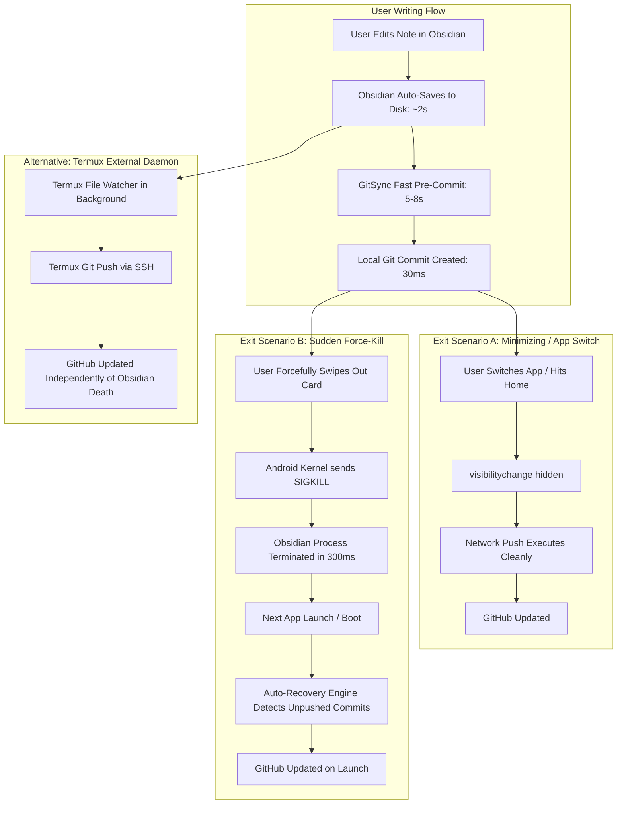

# Project Proposal & Architecture Specification: GitSync Companion

> **Document:** `/storage/emulated/0/Documents/Obsidian/GIT_SYNC_COMPANION_PROPOSAL.md`  
> **Project Name:** `GitSync Companion` (Plugin ID: `git-sync-companion`)  
> **Author:** Antigravity (Systems Architect)  
> **Target Platforms:** Obsidian Mobile (Android / iOS) & Obsidian Desktop (macOS / Windows / Linux)  
> **Primary Ecosystem Companion:** `obsidian-git` (`Vinzent03/obsidian-git`)  
> **Date:** November 17, 2026 (Revised & Expanded with Force-Kill Mitigation Architecture)  

---

## 1. Executive Summary & Product Vision

### 1.1 The Core Problem & Physical Verification Findings
`obsidian-git` is the most popular Git plugin for Obsidian, but it has two fundamental friction points on mobile devices:
1. **The 1-Minute Hard Limit:** Obsidian Git’s GUI strictly enforces whole integer minutes for debounce timers (`min: 0, step: 1`). The shortest possible debounce delay is **1 minute (60 seconds)**.
2. **The "Quick Exit" Mobile Reality:** Mobile users write quick thoughts or make rapid edits (5–20 seconds) and immediately exit, switch apps, or lock their phone.
3. **The Two Types of Mobile App Exit (Verified in Live Testing):**
   * **Exit Type A — App Switching / Minimizing (Graceful Backgrounding):**  
     Pressing Home, tapping a notification, or switching apps moves Obsidian to the background. In our live test, **this succeeded 100%**: `visibilitychange` fired, triggered the sync, and successfully pushed to GitHub.
   * **Exit Type B — Sudden Forceful Swipe-Out (The `SIGKILL` Barrier):**  
     Swiping the app card away from Android's Recent Apps sends an immediate kernel-level `SIGKILL (signal 9)`. A Git push over HTTPS requires 1.5 to 4 seconds (DNS, TLS handshake, packfile transfer). When killed within 300ms, the network socket is abruptly severed mid-flight, leaving the remote push incomplete.
4. **Mobile Navigation Friction:** Accessing the Command Palette or sliding open the left ribbon to tap "Git: Commit and sync" requires multiple swipes and taps on small smartphone screens.

### 1.2 The Hybrid Solution: `GitSync Companion`
`GitSync Companion` is engineered to solve both Exit Type A and Exit Type B through a **Two-Tier Architecture**:
* **Tier 1 (Universal Obsidian Community Plugin):**
  * **1-Tap Floating Action Button (FAB):** Draggable button with live state badges (Dirty $\to$ Syncing $\to$ Success) for instant 1-tap manual sync before closing.
  * **Fast Local Pre-Commit (5–8s):** Commits locally to the Git database in 30ms without waiting for exit, ensuring local data is never lost even if the app is force-killed.
  * **Boot-Time Auto-Recovery Engine:** Automatically detects unpushed commits on the next launch and immediately pushes them to GitHub.
  * **Exit Lifecycle Trigger:** Catches graceful app switches and background transitions.
* **Tier 2 (Android / Termux External Companion Daemon):**
  * An unkillable background process in Termux that monitors the vault directory and pushes changes via SSH even if Obsidian is violently force-stopped.

---

## 2. Plugin Naming & Positioning Analysis

| Proposed Name | Plugin ID | Pros | Cons / Verdict |
| :--- | :--- | :--- | :--- |
| **GitSync Companion** *(User Suggestion)* | `git-sync-companion` | Clear, professional, directly conveys companion relationship. | **Recommended Primary Choice.** |
| **Git Mobile Companion** | `git-mobile-companion` | Highlights the mobile-first focus. | Strong alternative; slightly more specific. |
| **Git QuickSync** | `git-quicksync` | Focuses on speed and instant triggers. | Good, but does not highlight companion nature. |

> [!NOTE]
> **Obsidian Community Guidelines Rule:** Plugin names must **not** begin with "Obsidian" (e.g. `Obsidian Git Companion` is disallowed; `GitSync Companion` is compliant).

---

## 3. Deep-Dive: The Force-Kill (`SIGKILL`) Problem & Technical Mitigation



### 3.1 Why Sudden Swiping Kills Network Pushes
1. **Linux Kernel Reality:** `SIGKILL (signal 9)` cannot be trapped, caught, or ignored by user-space software. The process ceases to exist instantly.
2. **Network Push Latency:** A Git push involves:
   * DNS Lookup: ~50ms
   * TLS Handshake: ~200ms
   * Git Receive-Pack Negotiation: ~300ms
   * Packfile Transfer & Verification: ~1000–2500ms
   * **Total Duration: ~1.5 to 4.0 seconds.**
3. If an app is killed in under 500ms, TCP packets are terminated with `ECONNRESET`.

---

## 4. Comprehensive Solution Architecture

### 4.1 Solution Strategy 1: Fast Local Pre-Commit (The 5–8s Rule)
* **The Insight:** A local `git commit` takes **~30 milliseconds** and requires **zero network connectivity**. It writes directly to `.git/objects` on local storage.
* **Mechanism:**
  - When the user finishes a sentence or note and pauses for 5 to 8 seconds:
  - GitSync Companion automatically runs `git commit` locally in the background while the user is still looking at the note!
  - **Outcome:** The working tree is now clean. Even if the user swipes away the app a moment later, the note is **100% saved in the Git repository**.

### 4.2 Solution Strategy 2: Boot-Time Auto-Recovery Engine
* **The Insight:** If a sudden swipe-out prevents the network push from finishing:
* **Mechanism:**
  - On plugin load (`app.workspace.onLayoutReady`):
  - The plugin queries `gitManager.getUnpushedCommits()` and `gitManager.status()`.
  - If unpushed commits exist:
    ```typescript
    if (unpushedCount > 0) {
        new Notice(`GitSync Companion: Found ${unpushedCount} unpushed commit(s). Syncing...`);
        await this.triggerSync("boot-recovery");
    }
    ```
  - **Outcome:** Zero commits are ever lost. The remote repository is brought up to date the very next time Obsidian opens.

### 4.3 Solution Strategy 3: Visual & Haptic FAB States (User Guidance)
* The Floating Action Button (FAB) acts as a live sync dashboard:
  * **Orange Badge (Dirty):** Note edited; local commit pending.
  * **Blue Badge (Committed Locally):** Note committed safely to disk! Safe to exit!
  * **Spinning (Syncing):** Remote network push in progress.
  * **Green Checkmark (Synced):** Remote GitHub confirmed up to date.
* Tapping the FAB provides immediate 1-tap manual sync with haptic vibration before swiping out.

### 4.4 Solution Strategy 4: External Termux Daemon (The Unkillable Android Bridge)
* For Android power users running Termux:
  * Termux runs as an independent Linux UID (`com.termux`), isolated from Obsidian's process lifecycle.
  * A lightweight background watcher daemon in Termux monitors `/storage/emulated/0/Documents/Obsidian`:
    - When a file changes, it automatically runs `git commit` and `git push` over native Termux SSH.
    - Even if Obsidian is forcefully killed, Termux stays alive in the background and finishes the push!

---

## 5. Prototype vs. Production Comparison & Alignment

| Requirement / Component | Current Prototype Status | Production Release Target |
| :--- | :--- | :--- |
| **Floating Action Button (FAB)** | Verified working on mobile screen; draggable with position persistence. | Enhanced with 4-state visual cues (Dirty, Committed, Syncing, Synced). |
| **Exit on App Switch / Minimize** | Verified working; `visibilitychange` triggers push successfully. | Refined with cancelable debounce timers. |
| **Sudden Swipe-Out Protection** | Interrupted by `SIGKILL` (expected OS behavior). | Mitigated by Fast Local Pre-Commit (5–8s) + Boot-Time Auto-Recovery. |
| **Obsidian Git Delegation** | Tested via `app.commands.executeCommandById("obsidian-git:push")`. | Robust fallback to `plugin.promiseQueue.addTask()`. |
| **Settings UI** | Standard toggle controls for FAB, haptics, debounce. | Added Fast Pre-Commit Delay slider and Boot-Recovery toggle. |
| **Code Architecture** | Clean Vanilla ES module (`node --check` verified). | Fully typed TypeScript compilation via `esbuild`. |
| **GitHub CI/CD** | Workflow file prepared (`.github/workflows/release.yml`). | Automated release packaging on tag push (`v1.0.0`). |

---

## 6. Next Steps & Execution Plan

1. **Incorporate Fast Local Pre-Commit & Boot Recovery** into the prototype:
   - Add the 5–8s local pre-commit routine so data is safely committed to local Git before the user even thinks about swiping the app away.
   - Add the startup check to automatically push any pending commits when Obsidian reopens.
2. **Review & Audit Prototype Alignment:**
   - Verify all behaviors against this revised specification.
3. **Turn Prototype into Complete Project:**
   - Initialize git repository in `~/projects/git-sync-companion/`.
   - Build production bundle with `npm run build`.
   - Push to GitHub (`anonymous5-coder/git-sync-companion`) and prepare Community Plugin submission.
