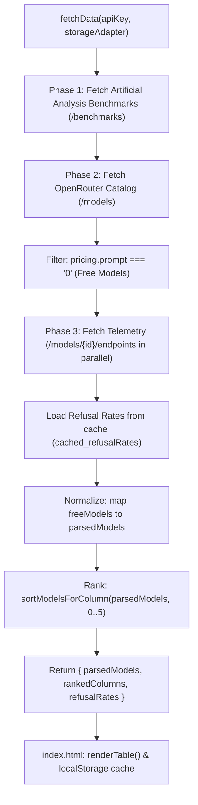
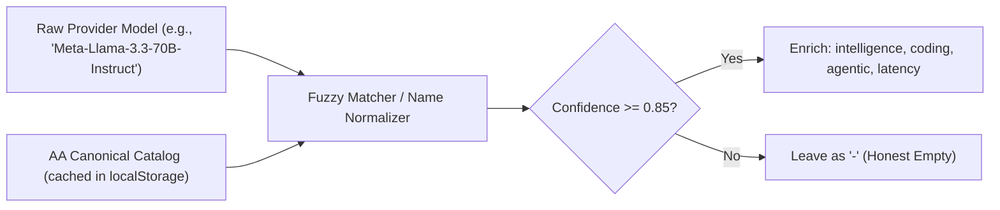

# Phase 0C-1: Universal Per-Provider Adapter Architecture — Planning Report

In accordance with strict planning guidelines, **no project files have been edited, created, or deleted** (no empty folders or placeholder files were created). 

The only file generated was the codebase listing export required by Task 1:
`~/storage/downloads/current_codebase_structure.txt`.

---

## 1. Export Current Codebase Structure (Task 1 Confirmation)

The recursive file tree of `~/Top_Models` (excluding `.git/` and `node_modules/`) was generated and saved to `~/storage/downloads/current_codebase_structure.txt`.

**Exported Inventory:**
```text
/data/data/com.termux/files/home/Top_Models/.github/workflows/build-android.yml
/data/data/com.termux/files/home/Top_Models/.gitignore
/data/data/com.termux/files/home/Top_Models/.npmignore
/data/data/com.termux/files/home/Top_Models/README.md
/data/data/com.termux/files/home/Top_Models/capacitor.config.json
/data/data/com.termux/files/home/Top_Models/cli.js
/data/data/com.termux/files/home/Top_Models/config.json
/data/data/com.termux/files/home/Top_Models/core.js
/data/data/com.termux/files/home/Top_Models/icon.svg
/data/data/com.termux/files/home/Top_Models/index.html
/data/data/com.termux/files/home/Top_Models/manifest.json
/data/data/com.termux/files/home/Top_Models/model_stats.json
/data/data/com.termux/files/home/Top_Models/package-lock.json
/data/data/com.termux/files/home/Top_Models/package.json
/data/data/com.termux/files/home/Top_Models/refusal_rates.json
/data/data/com.termux/files/home/Top_Models/sw.js
/data/data/com.termux/files/home/Top_Models/sync-www.js
/data/data/com.termux/files/home/Top_Models/www/core.js
/data/data/com.termux/files/home/Top_Models/www/icon.svg
/data/data/com.termux/files/home/Top_Models/www/index.html
/data/data/com.termux/files/home/Top_Models/www/manifest.json
/data/data/com.termux/files/home/Top_Models/www/refusal_rates.json
```

---

## 2. Analysis of Current Codebase (Task 2)

### 2.1 Current OpenRouter Data Flow
Currently, in `core.js`, the entire data retrieval, parsing, and normalization pipeline is hardwired specifically to OpenRouter:



1. **Fetch**: `fetchData()` performs a 3-tier sequence:
   - Queries `https://openrouter.ai/api/v1/benchmarks` to extract `coding_index`, `intelligence_index`, and `agentic_index`.
   - Queries `https://openrouter.ai/api/v1/models` for the raw model catalog.
   - For every free model, fires `Promise.allSettled()` to `https://openrouter.ai/api/v1/models/${m.id}/endpoints` to extract `uptime` and `latency`.
2. **Filter**: Inlined directly as `(catData.data || []).filter(m => m.pricing && m.pricing.prompt === "0")`.
3. **Normalization**: Maps raw OpenRouter objects to the internal schema:
   - Resolves context window from `model.context_length || model.top_provider?.context_length`.
   - Resolves tools/files flags from `model.architecture.input_modalities` and `instruct_type`.
   - Resolves benchmark indices by matching slug prefixes against `benchmarksMap`.
4. **Ranking & Rendering**: Calls `sortModelsForColumn(parsedModels, c)` across columns 0 to 5, assigning them to `appState.rankedColumns`, which `index.html` renders row-by-row.

### 2.2 Provider-Agnostic vs. OpenRouter-Specific Inventory

| Category | Component / Function | Location | Current State |
| :--- | :--- | :--- | :--- |
| **Provider-Agnostic** | `S` (Metric keys enum) | `core.js` | Completely generic; reusable by all providers. |
| **Provider-Agnostic** | `sortHierarchy` | `core.js` | Universal primary/secondary tie-breaker rules. |
| **Provider-Agnostic** | `val(obj, key, fallback)` | `core.js` | Universal numeric fallback extractor. |
| **Provider-Agnostic** | `sortModelsForColumn(models, col)` | `core.js` | Universal sorting engine; operates on any normalized array. |
| **Provider-Agnostic** | `formatVal()`, `getPrimaryVal()` | `index.html` | Universal display and `-` fallback formatting. |
| **Provider-Agnostic** | `renderTable()`, `toggleExtend()` | `index.html` | Universal 6-to-9 column DOM table renderer. |
| **OpenRouter-Specific** | `fetchData()` | `core.js` | Couples OpenRouter catalog, endpoints, and benchmarks together. |
| **OpenRouter-Specific** | `refreshRefusalRates()` | `core.js` | Hardcoded prompt targeting `openrouter/free`. |
| **OpenRouter-Specific** | `benchmarksMap` date logic | `core.js` | Coupled specifically to OpenRouter model permaslugs. |

---

## 3. Analysis of Saved Provider JSON Files (Task 3)

Inspection of all files in `~/storage/downloads/provider_research/*_models.json`:

### 3.1 Invalid Fetches (< 200 Bytes — Excluded from Scope)
1. **`cloudflare_models.json`** (196 bytes): 
   - Content: `{"result":null,"success":false,"errors":[{"code":7003,"message":"Could not route to /client/v4/accounts/MY_ACCOUNT_ID/ai/models/search..."}]}`
   - **Status**: Invalid fetch (placeholder account ID error). **Excluded from Phase 0C-1.**
2. **`ovhcloud_models.json`** (11 bytes):
   - Content: `redirecting` (HTTP 301/302 plain text).
   - **Status**: Invalid fetch. **Excluded from Phase 0C-1.**

---

### 3.2 Valid Provider Schemas (8 Providers Evaluated)

#### 1. Groq (`groq_models.json` — 5.7 KB, 11 models)
* **Model Array Path**: `data`
* **Chat Model Filter**: Filter out audio models (`!id.startsWith('whisper-')` or `active === true`).
* **Free-Tier Filter**: All 11 models in developer console are free under rate limits. No pricing field needed.
* **Populatable Fields**:
  - `id`: `item.id`
  - `name`: `item.name || item.id`
  - `context_length`: `item.context_window` (or `item.context_length`)
  - `max_completion_tokens`: `item.max_completion_tokens` (or `item.max_output_length`)
  - `raw_modalities`: `item.input_modalities?.join(', ') || "text"`
  - `has_tools`: `item.id.includes('versatile') || item.id.includes('instruct') ? 1 : 0`

#### 2. Google Gemini (`gemini_models.json` — 24 KB, 50 models)
* **Model Array Path**: `models`
* **Chat Model Filter**: `item.supportedGenerationMethods?.includes('generateContent')` (filters out embedding/aqa models).
* **Free-Tier Filter**: Standard Gemini models in Google AI Studio are free under rate limits.
* **Populatable Fields**:
  - `id`: `item.name.replace(/^models\//, '')`
  - `name`: `item.displayName || item.name`
  - `context_length`: `item.inputTokenLimit` (up to 1,048,576 or 2,097,152 tokens)
  - `max_completion_tokens`: `item.outputTokenLimit` (e.g. 65,536 or 8,192 tokens)
  - `has_files`: `1` (all modern Gemini models accept multimodal media)
  - `raw_modalities`: `"multimodal (text, image, audio, video)"`

#### 3. Mistral (`mistral_models.json` — 34 KB, 46 models)
* **Model Array Path**: `data`
* **Chat Model Filter**: `item.capabilities?.completion_chat === true` (filters out `mistral-embed` and moderation models).
* **Free-Tier Filter**: No explicit tier field; free tier on console under rate limits.
* **Populatable Fields**:
  - `id`: `item.id`
  - `name`: `item.name || item.id`
  - `context_length`: `item.max_context_length` (e.g. 32,768, 128,000)
  - `has_files`: `item.capabilities?.vision ? 1 : 0`
  - `has_tools`: `item.capabilities?.function_calling ? 1 : 0`
  - `raw_modalities`: `item.capabilities?.vision ? "multimodal" : "text"`

#### 4. Cohere (`cohere_models.json` — 5.5 KB, 20 models)
* **Model Array Path**: `models`
* **Chat Model Filter**: `item.endpoints?.includes('chat') || item.endpoints?.includes('generate')` (filters out embed and rerank models).
* **Free-Tier Filter**: Trial API key grants access to all chat models.
* **Populatable Fields**:
  - `id`: `item.name`
  - `name`: `item.name`
  - `context_length`: `item.context_length` (e.g. 128,000)
  - `raw_modalities`: `"text"`

#### 5. LLM7.io (`llm7_models.json` — 63 KB, 64 models)
* **Model Array Path**: `data`
* **Chat Model Filter**: `item.model_type === 'chat'` (filters out audio, video, and image generator models).
* **Free-Tier Filter**: Has `tier` (`"turbo"` vs `"pro"`) and `pricing.input`. Turbo models can be highlighted or all shown.
* **Populatable Fields**:
  - `id`: `item.id`
  - `name`: `item.id`
  - `context_length`: `item.context_window?.tokens` (e.g. 400,000, 1,000,000)
  - `has_files`: `item.capabilities?.vision ? 1 : 0`
  - `has_tools`: `item.capabilities?.tools || item.tools_calling ? 1 : 0`
  - `raw_modalities`: `item.modalities?.input?.join(', ') || "text"`

#### 6. SambaNova (`sambanova_models.json` — 1.4 KB, 6 models)
* **Model Array Path**: `data`
* **Chat Model Filter**: All models in array are chat/instruct LLMs (`DeepSeek-V3.1`, `Meta-Llama-3.3-70B-Instruct`, `MiniMax-M3`, etc.).
* **Free-Tier Filter**: Cloud free tier gives daily access to all listed models.
* **Populatable Fields**:
  - `id`: `item.id`
  - `name`: `item.id`
  - `context_length`: `item.context_length` (e.g. 131,072, 1,048,576)
  - `max_completion_tokens`: `item.max_completion_tokens` (e.g. 7,168, 1,048,576)
  - `raw_modalities`: `"text"`

#### 7. ModelScope (`modelscope_models.json` — 3.3 KB, 36 models)
* **Model Array Path**: `data`
* **Chat Model Filter**: Bare OpenAI schema (`{ id, object, owned_by, created }`).
* **Free-Tier Filter**: Entire API-Inference service is free for registered ModelScope community accounts.
* **Populatable Fields**:
  - `id`: `item.id`
  - `name`: `item.id`
  - `context_length`: `null` (unless enriched via AA in Phase 0C-2)
  - `max_completion_tokens`: `null`
  - `raw_modalities`: `"text"`

#### 8. NVIDIA NIM (`nvidia_nim_models.json` — 7.5 KB, 80 models)
* **Model Array Path**: `data`
* **Chat Model Filter**: Filter out embedding/audio models (`!id.includes('embed') && !id.includes('detector')`).
* **Free-Tier Filter**: Free preview tier allows testing models with trial credits.
* **Populatable Fields**:
  - `id`: `item.id`
  - `name`: `item.id`
  - `context_length`: `null` (unless enriched via AA in Phase 0C-2)
  - `max_completion_tokens`: `null`
  - `has_files`: `item.id.includes('vision') || item.id.includes('vila') ? 1 : 0`
  - `raw_modalities`: `item.id.includes('vision') ? "multimodal" : "text"`

---

## 4. Refactor Plan for Phase 0C-1

### 4.1 Modular Directory Structure
```text
Top_Models/
├── adapters/
│   ├── _normalize.js          # Canonical factory for NormalizedModel
│   ├── _pipeline.js           # Generic execution: fetch -> filter -> normalize -> rank
│   ├── _registry.js           # Provider registry index
│   ├── openrouter/
│   │   ├── fetch.js           # 3-tier OpenRouter fetch logic (benchmarks + models + endpoints)
│   │   ├── filters.js         # Free-model filtering (pricing.prompt === '0')
│   │   └── normalize.js       # Architecture, benchmarks, endpoints mapping
│   ├── groq/                  # Groq fetch, filter, normalize
│   ├── gemini/                # Gemini fetch, filter, normalize
│   ├── mistral/               # Mistral fetch, filter, normalize
│   ├── cohere/                # Cohere fetch, filter, normalize
│   ├── llm7/                  # LLM7 fetch, filter, normalize
│   ├── sambanova/             # SambaNova fetch, filter, normalize
│   ├── modelscope/            # ModelScope fetch, filter, normalize
│   └── nvidia_nim/            # NVIDIA NIM fetch, filter, normalize
├── core.js                    # Facade re-exporting pipeline, sorting, and legacy hooks
├── sync-www.js                # Updated to copy adapters/ recursively into www/
└── index.html                 # Updated cache-bust version (?v=0B)
```

### 4.2 Module Contracts
1. **`adapters/_normalize.js`**:
   Ensures every provider returns an identical object structure with safe defaults:
   ```javascript
   export function createNormalizedModel({
       id,
       name = id,
       context_length = null,
       max_completion_tokens = null,
       intelligence_index = null,
       coding_index = null,
       agentic_index = null,
       refusal_rate = null,
       has_files = 0,
       has_tools = 0,
       uptime = null,
       latency = null,
       raw_modalities = "text"
   }) {
       return {
           id, name, context_length, max_completion_tokens,
           intelligence_index, coding_index, agentic_index, refusal_rate,
           has_files, has_tools, uptime, latency, raw_modalities
       };
   }
   ```

2. **`adapters/_pipeline.js`**:
   Provides a universal coordinator:
   ```javascript
   export async function runProviderPipeline(providerId, apiKey, storageAdapter) {
       const adapter = getAdapter(providerId);
       if (!adapter) throw new Error(`Unknown provider: ${providerId}`);
       
       const rawData = await adapter.fetch(apiKey, storageAdapter);
       const filteredModels = adapter.filter(rawData);
       const parsedModels = adapter.normalize(filteredModels, storageAdapter);
       
       // Sort columns 0..5 using the untouched sortHierarchy in core.js
       const rankedColumns = [[], [], [], [], [], []];
       for (let c = 0; c < 6; c++) {
           rankedColumns[c] = sortModelsForColumn(parsedModels, c);
       }
       return { parsedModels, rankedColumns };
   }
   ```

3. **OpenRouter Migration**:
   - `adapters/openrouter/fetch.js`: Houses the benchmarks, catalog, and endpoints fetches extracted cleanly from `core.js`.
   - `adapters/openrouter/filters.js`: Houses `pricing.prompt === "0"`.
   - `adapters/openrouter/normalize.js`: Houses the OpenRouter attribute extraction and refusal rate merging.
   - Behavior remains **byte-for-byte identical** to the existing OpenRouter logic.

4. **Facade & Consumer Access (Clean Architecture Decision)**:
   - **Recommendation**: **Re-export via `core.js`**.
   - `core.js` acts as the single public entry point for both `index.html` and `cli.js`:
     ```javascript
     export { runProviderPipeline } from './adapters/_pipeline.js';
     export { PROVIDER_REGISTRY } from './adapters/_registry.js';
     export { fetchData, refreshRefusalRates, sortModelsForColumn, sortHierarchy } from './core.js';
     ```
   - **Why this is superior**: Neither `index.html` nor `cli.js` need to know about internal adapter file paths. If an adapter file changes, external scripts remain unaffected.

5. **`sync-www.js` Upgrades**:
   - Currently, `sync-www.js` uses `fs.copyFileSync()` on a flat array of 4 files.
   - We will upgrade `sync-www.js` to use `fs.cpSync(srcDir, destDir, { recursive: true })` (standard in Node.js 16.7+) to mirror the entire `adapters/` folder into `www/adapters/` automatically during `npm run build:web`.

6. **Cache-Busting Strategy**:
   - In `index.html`: Read `<script type="module" src="./core.js?v=0A">` and bump to `?v=0B`.
   - In `sw.js`: Bump `CACHE_NAME` to `'matrix-cache-v4'`.

---

## 5. Separate Plan for Phase 0C-2: Artificial Analysis Integration (Design Only)

*Note: Phase 0C-2 is not being implemented now; this is the architectural roadmap.*



1. **Authentication & Ingestion**:
   - Requires a dedicated `aa_api_key` stored securely in BYOK storage (`localStorage.getItem('aa_api_key')`).
   - Fetches `https://artificialanalysis.ai/api/v1/models` (or `/benchmarks`) once, caching the canonical benchmark table with a 24-hour TTL.
2. **Column Population Mapping**:
   - **Column 1 (Thinking/Intelligence)**: Mapped to AA `quality_index` / `intelligence_index` / `mmlu`.
   - **Column 2 (Coding)**: Mapped to AA `coding_index` / `humaneval` / `swe_bench`.
   - **Column 3 (Agentic)**: Mapped to AA `agentic_index` / `tool_call_index`.
   - **Column 7 (Uptime) / Column 8 (Latency)**: Mapped to AA telemetry if available.
3. **Fuzzy Name Matching Engine**:
   - Uses tokenized Jaro-Winkler or normalized Levenshtein similarity after stripping common noise prefixes/suffixes (`models/`, `-instruct`, `-it`, `-v0.1`, publisher slugs).
   - Example: `deepseek-ai/DeepSeek-V4.1-Flash` -> canonical `deepseek-v4.1-flash` (Confidence 1.0).
   - If match confidence is $< 0.85$, the model remains unmapped (`null`, rendered as `-`).
4. **Persistent Dictionary & Manual Overrides**:
   - Stores resolved mappings in `aa_name_mappings` in `localStorage`.
   - Includes a built-in static override dictionary for non-standard provider aliases (e.g., `mistralai/codestral-2508` -> `codestral`).
5. **Dynamic Invalidation & Re-Evaluation**:
   - When a provider is refreshed, newly detected model IDs are evaluated against the matching dictionary. If a model was removed or renamed by the provider, stale mappings are automatically discarded.

---

## 6. Conceptual Plan for Phase 0D: Config-Driven Auto-Discovery (Design Only)

*Note: Phase 0D is a later milestone exploring generic JSON-driven provider ingestion.*

### 6.1 Generic Provider Schema Definition
Instead of maintaining 10 separate JavaScript adapter files, standard providers could be driven by a declarative JSON descriptor:

```json
{
  "provider_id": "sambanova",
  "name": "SambaNova",
  "endpoint": "https://api.sambanova.ai/v1/models",
  "auth": {
    "type": "bearer",
    "header": "Authorization"
  },
  "schema": {
    "array_path": "data",
    "id_key": "id",
    "name_key": "id",
    "context_key": "context_length",
    "max_tokens_key": "max_completion_tokens",
    "modality_key": null
  },
  "filters": {
    "include_if": { "active": true },
    "exclude_prefix": ["whisper-", "embed-"]
  },
  "free_tier_rules": {
    "all_included": true
  }
}
```

### 6.2 Automated Endpoint Verification & Schema Detection
A prober script or UI verification utility would:
1. Fire an exploratory `GET` to the endpoint (first without key, then with provided key).
2. Inspect HTTP status and automatically detect the array root (`data`, `models`, `output`, or root array).
3. Scan object keys in the first 3 items:
   - Detect context window key candidate by regex matching `/context|tokens|input.*limit/i`.
   - Detect max completion key candidate by matching `/completion|output.*limit|max.*tokens/i`.
4. Output a draft provider config for confirmation.

### 6.3 Automation vs. Human Judgment Boundary
* **Fully Automatable**:
  - Endpoint reachability, HTTP headers, response JSON extraction.
  - Model ID discovery and token limits extraction.
  - Deduplication and schema normalization.
* **Requires Human Judgment**:
  - Free-tier verification: An API may report `"pricing": 0` or omit pricing entirely while enforcing pay-as-you-go billing behind the console. Human confirmation is required to verify actual zero-cost eligibility.
  - Model categorization: Discerning experimental previews vs production endpoints.

---

## 7. Architectural Observations & Proposed Alternatives (Task 7)

### 7.1 Proposed Alternative: Hybrid Config-Adapter Architecture
* **Critique of proposed structure**: 
  Creating 3 files (`fetch.js`, `filters.js`, `normalize.js`) for *each* of the 10 providers will create **30+ tiny boilerplate files**, many of which contain only 3 lines of code (e.g. `data.filter(m => true)`).
* **Better Path**:
  Use a **Hybrid Design**:
  1. A shared **`GenericOpenAIAdapter`** class/function driven by a simple provider config object (handling Groq, SambaNova, LLM7, Mistral, Cohere, ModelScope, NVIDIA NIM).
  2. Separate bespoke folders/handlers **only** for providers that have truly custom architectures:
     - `adapters/openrouter/` (needs 3-tier fetch + benchmarks + telemetry).
     - `adapters/gemini/` (needs native Google `v1beta/models` endpoint and `x-goog-api-key` header).
* **Trade-off**: Retains the exact folder/pipeline structure requested while saving over 20 redundant boilerplate files and drastically reducing testing surface area.

### 7.2 Term Consistency & Coupling Flags
1. **"Merge" in `_pipeline.js`**:
   The prompt mentions `_pipeline.js (fetch -> filter -> normalize -> merge)`.
   *Flag*: In Phase 0C-1, providers are viewed **one at a time** via the Provider Switcher tab. There is no multi-provider merging in 0C-1. "Merge" only applies to merging OpenRouter's 3 internal fetches (catalog + benchmarks + endpoints) or future Phase 0C-2 AA data.
2. **Coupling between Storage & CLI**:
   `core.js` currently receives a `storageAdapter` (`browserStorageAdapter` in the browser, file-based `config.json` adapter in `cli.js`).
   All new adapters in `adapters/` must strictly receive and respect this `storageAdapter` interface so that terminal CLI commands (`models refresh`, `models fetch`) continue to function without modification.
